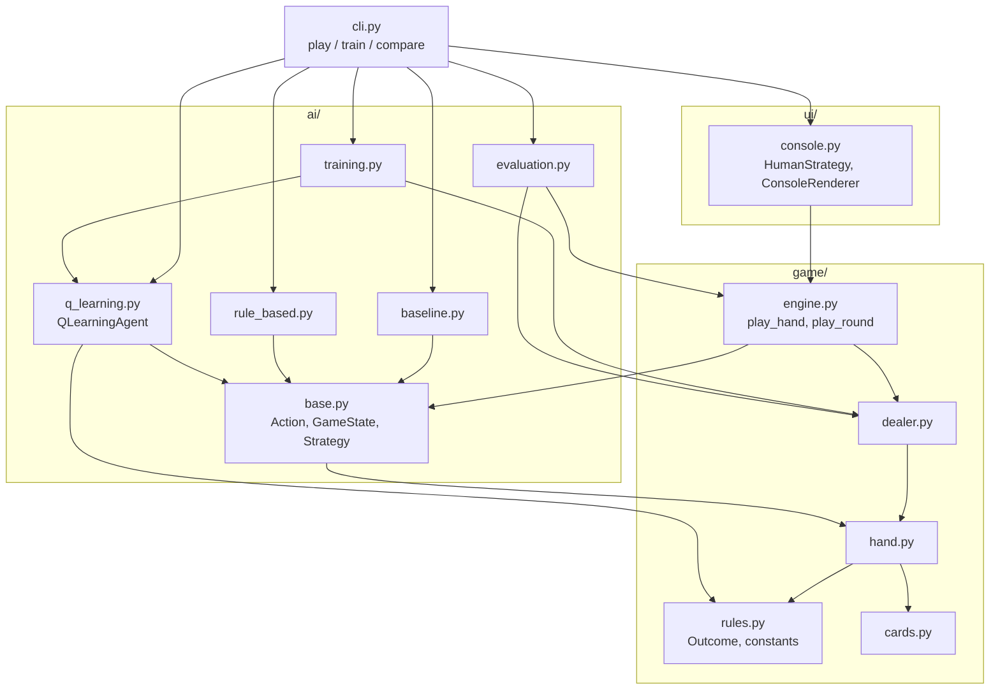

# Architecture

## Module map

An arrow means "imports". Transitive dependencies are left out to keep the diagram readable.

`game/engine.py` imports `ai/base.py` for the `Strategy` protocol and `GameState`, so the layers are not strictly one-way. `ai/base.py` only needs `game/cards.py` and `game/hand.py`, which keeps the two packages from importing each other in a cycle.

| Module | Responsibility |
|---|---|
| `game/cards.py` | Deck creation (`create_deck(rng)`) and card values. Cards are dicts: `{"rank": "Ace", "suit": "Hearts"}` |
| `game/hand.py` | `calculate_score`, `has_usable_ace`, `is_bust` |
| `game/rules.py` | `BLACKJACK = 21`, `DEALER_STAND = 17`, the `Outcome` enum and `evaluate_outcome` |
| `game/dealer.py` | `dealer_should_hit`, `play_dealer` (silent; returns the cards drawn) |
| `game/engine.py` | `play_hand(strategy, ...)` and `play_round(player, ai, ...)`; reports progress as `Event`s |
| `ai/base.py` | `Action`, `GameState`, the `Strategy` protocol, `get_game_state` |
| `ai/baseline.py`, `ai/rule_based.py`, `ai/q_learning.py` | The three strategies |
| `ai/training.py` | `train_episode`, `train(games, seed)` |
| `ai/evaluation.py` | `play_solo_game`, `compare_strategies` |
| `ui/console.py` | All `print()` and `input()`: `HumanStrategy`, `ConsoleRenderer`, `play_game` |
| `cli.py` | `play`, `train`, and `compare` subcommands |

## Design rules

- **No printing in `game/` or `ai/`.** The engine returns results and emits events; `ui/console.py` renders them. This keeps the logic testable without capturing stdout and lets training use the same dealer as the real game.
- **One `Strategy` protocol for every player.** `decide(GameState) -> Action` is the only contract. The human, baseline, rule-based, and Q-learning players are interchangeable in `play_hand`.
- **Randomness is always injected.** `create_deck`, `train`, and the Q-learning agent take a `random.Random`, so a seed reproduces a result exactly.
- **One `Outcome` enum.** Q-learning maps it to rewards through `REWARDS` (+1, -1, 0).

## How a round flows

`play_round(player, ai, rng=..., emit=...)`:

1. **Deal.** A shuffled deck is created. Player, AI, and dealer each receive two cards, dealt in turn. Each card emits a `deal` event; only the dealer's second (hole) card is marked not visible, and the console shows it as `[hidden]` until the dealer's turn.
2. **Player turn.** `play_hand(player, ...)` loops: emit the score; stop if bust; ask the strategy for a `GameState` decision; on `HIT` draw a card and emit it; on `STAND` stop.
3. **AI turn.** The same `play_hand` runs with the AI strategy. The AI plays even if the player busted.
4. **Dealer turn.** If at least one of the two players has not busted, `play_dealer` draws until the dealer reaches 17.
5. **Result.** `evaluate_outcome` compares each player's score to the dealer's and the engine returns a `RoundResult` with all hands, scores, and outcomes.

The Q-learning trainer and the comparison tool call the same game pieces (`create_deck`, `play_dealer`, `evaluate_outcome`), so training, evaluation, and real play cannot drift apart.

## Events

`Event(kind, who, card, score, visible)` where `kind` is one of `deal`, `turn`, `score`, `hit`, `stand`, `bust`, or `empty` (the deck ran out). Pass any callable as `emit`; the console renderer is one example, and tests use `list.append`.
